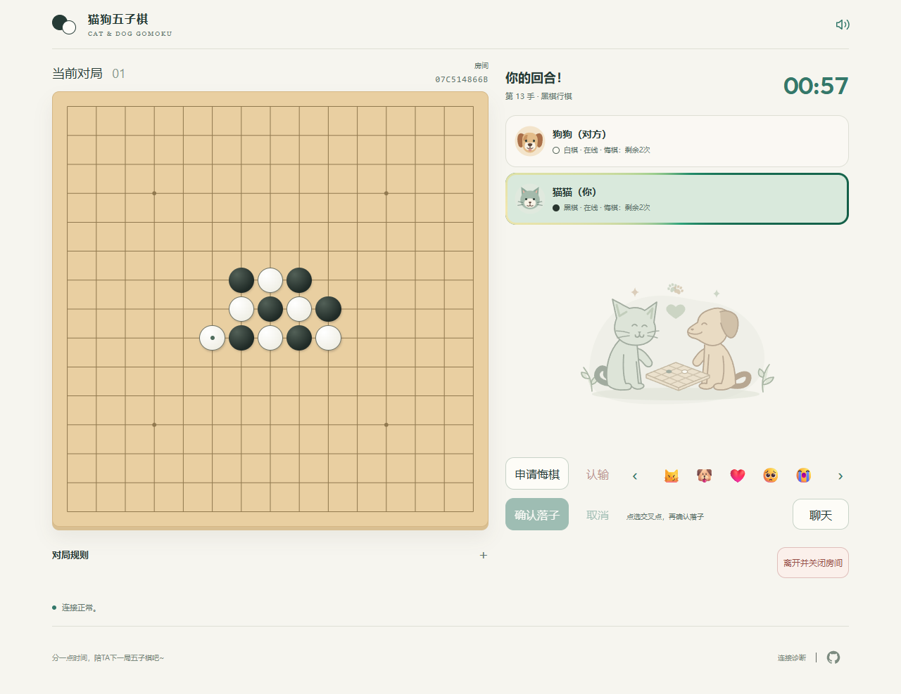
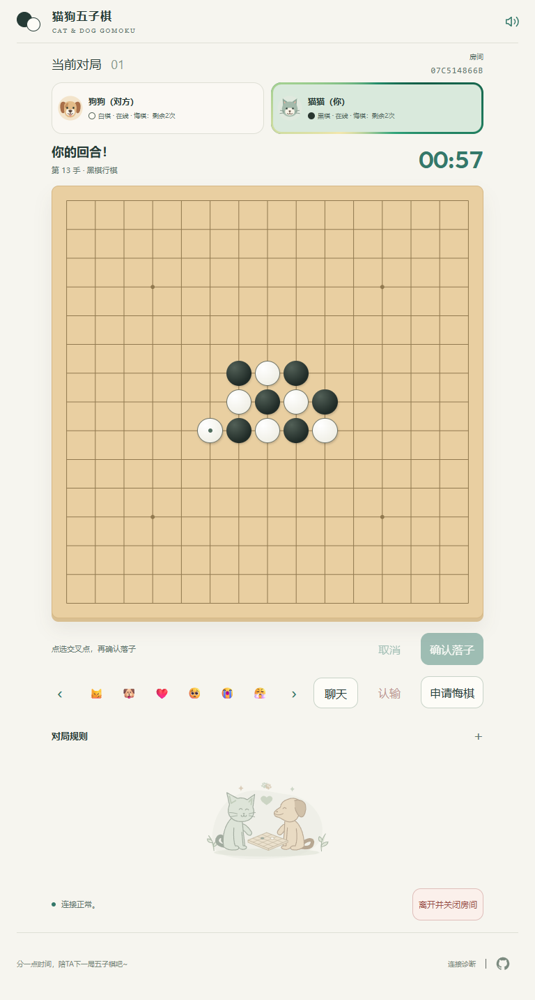
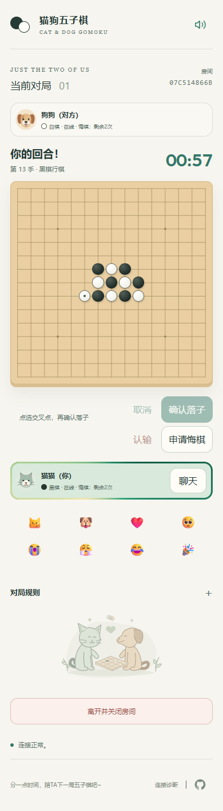
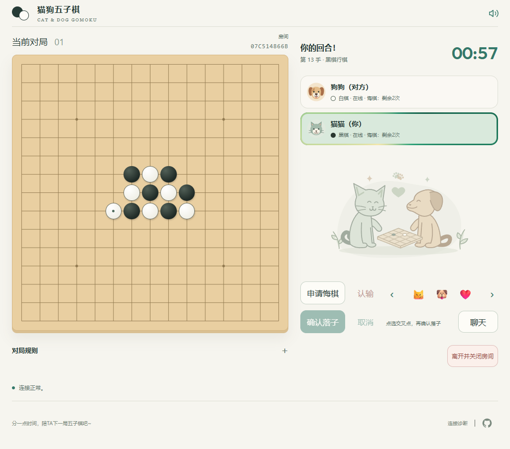
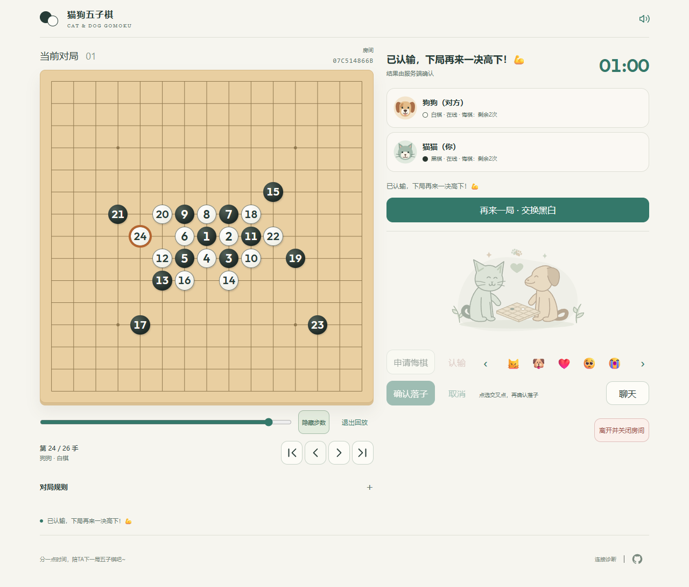

<h1 align="center">🐱 Cat &amp; Dog Gomoku 🐶</h1>

<p align="center">English | <a href="README.zh-CN.md">简体中文</a></p>

<p align="center"><a href="https://cat-and-dog-gomoku-d4c9e5cfbbfc0-1513741929.tcloudbaseapp.com/gomoku/">Play online</a> | <a href="#screenshots">Screenshots</a> | <a href="https://github.com/REEEEEAAAAAL/cat-dog-gomoku">Source code</a></p>

A small online Gomoku game for two people. Pick a cat or dog, send an invitation, and play together on a 15×15 board. Built for phones, tablets, and desktops, with no account registration and a Simplified Chinese interface.

The hosted game uses a CloudBase prepaid environment with limited validity and quotas. Its default domain may show a confirmation page before opening the game.

## Features

- Multiple private rooms can host games at the same time, each limited to two players, with independent game states that do not affect one another. Join via invitation links or ten-character room codes; play starts after host approval and both players are ready.
- Five or more stones in a row wins. Preview a position, then confirm the move to avoid accidental placement; mouse, touch, and keyboard are supported.
- Server-managed 60-second turns, disconnect pauses, and recovery after refresh. A five-minute unresolved disconnect ends the round without a winner.
- Negotiated undo, up to two successful uses per player per round; both players review the affected stones before approval.
- Resignation at any time after a round starts, with confirmation and a server-persisted result; no opponent approval is needed.
- Review the finished round on the same board with a progress slider and four controls: start, previous, next, and end. Toggle move numbers and follow the highlighted current move with player and color labels. Replay is local and independent for each player; undone moves are excluded and past rounds are not permanently archived.
- Rematches with swapped colors, eight fixed reactions, and local sound effects with a persistent mute setting. A short opening cue plays when each new game starts; restored or stale openings stay silent.
- Room text chat for seated players, with unread indicators and retryable sends. Messages are limited to 100 characters; the latest 50 survive refresh and rematches.

There is no matchmaking, spectator mode, or computer opponent. An invitation grants permission to apply, not ownership of a player's seat. Returning players use the same browser session; another browser cannot take over their identity. Leaving closes the room for both players, and rooms expire after 24 hours.

## Design

The frontend uses strict TypeScript, Vite, native DOM/SVG, and Web Audio. CloudBase provides anonymous sessions, static hosting, and a PostgreSQL HTTP RPC backend. Vitest, PGlite, and Playwright cover rules, SQL behavior, and browser flows.

- **The server decides.** Each `gomoku_command` call locks the room row, validates the player, game, version, turn, and position, and persists state before acknowledging it. Browsers cannot directly read or write the game table. A preview becomes a stone only after confirmation from the server.
- **Retries preserve intent.** Operation IDs and stored receipts prevent duplicate moves after a lost response. An uncertain result remains visible for retry and reconciliation. Refresh restores the session, and a new tab takes over that browser's seat.
- **Polling keeps deployment simple.** Active, visible pages normally poll every five seconds. A player who is ready and waiting for a new game polls about once per second until it starts. Partner updates can take one polling interval. Hidden pages stop polling; waiting and finished pages also rest after two minutes without interaction. A 15-second heartbeat lease tolerates brief interruptions before pausing play.
- **Time survives reconnects.** PostgreSQL stores deadlines and remaining time. Both players must reconnect and acknowledge synchronization to resume. Expired timers are settled by the next RPC, including when both players have been absent; there is no background scheduler.
- **Chat stays separate.** Chat uses independent requests and message IDs, preserving game operations, timers, and retries. An active chat panel supplements normal polling; background pages stop polling.

The maintained deployment uses CloudBase PostgreSQL and HTTP polling; PostgreSQL Realtime is not enabled.

## Text chat

Text chat is available in the hosted game after both players have taken their seats. Open **聊天** in your player card on a phone, or below the reactions on desktop. Enter sends, Shift+Enter adds a line, and the Send button supports touch input; selecting text with an input method does not send it.

An unread count and soft green button indicate new messages. Messages remain unread while you browse older messages or the page is hidden, and clear once the latest messages are visible. New messages follow the bottom when you are already there; otherwise your reading position stays in place. The floating down-arrow returns to the latest message, and sending your own message also scrolls there.

Each message allows 100 Unicode code points. The server retains the latest 50 messages across refreshes and rematches in the same room; each player can send once every two seconds and at most ten times per minute. An unconfirmed send can be retried without duplication. Room expiration blocks further access; deletion of a room also removes its chat data. There are no background push notifications.

## Run locally

Use Node.js 22 or newer and npm; development has been verified on Node.js 24.

```sh
npm ci
```

For a fully local game with an in-memory PostgreSQL-compatible database and no cloud credentials:

```sh
node node_modules/vite/bin/vite.js --config game.test.config.ts --configLoader runner --host 127.0.0.1 --port 18790
```

Open `http://127.0.0.1:18790` in two separate browser profiles or a normal and private window. Create a room, share its invitation, approve the other player, and ready up. This development adapter bypasses CloudBase authentication and loses its data when stopped; do not deploy it.

To work against your own CloudBase backend, copy `.env.example` to `.env.local`, set `VITE_CLOUDBASE_ENV_ID` and `VITE_CLOUDBASE_PUBLISHABLE_KEY`, and run:

```sh
npm run dev
```

This requires a PostgreSQL environment with anonymous login, an allowed web origin, and the migrations below. The current client configures the Shanghai region. Vite variables are embedded in the browser bundle: use only a frontend publishable key, never management credentials.

The game layout responds to available width and height. Desktop and wide landscape windows place both player cards and the timer to the right of the board; portrait tablets and medium windows place the cards side by side above it. Low-height windows use a compact header and tighter spacing to preserve board space, with scrolling for crowded status panels. Replay and collapsible rules sit below the board; wide layouts keep player cards and actions stable as room states change, and show the illustration only when space permits. Phones retain touch preview and stacked player cards, with confirm/undo on the right and cancel/resign on the left. Replay navigation stays on one row, and invitation buttons keep their size when showing copy success.

Chat opens in a collapsible overlay without resizing the board, with an entry in the player card on phones and near the game controls on larger screens.

## Tests and builds

```sh
npm run typecheck
npm run lint
npm test
npm run build:cloudbase
```

Unit tests run the SQL migrations in isolated PGlite instances with a controlled server clock, alongside protocol, rules, audio-event, HTTP, and chat tests. They require no cloud credentials.

Browser tests use installed Microsoft Edge by default. Set `GOMOKU_BROWSER=chrome` to use installed Google Chrome. To run the game flows against local SQL in PowerShell:

```powershell
$env:GOMOKU_LOCAL_SQL = '1'
npm run test:game-page
Remove-Item Env:GOMOKU_LOCAL_SQL
```

On macOS/Linux, use `GOMOKU_LOCAL_SQL=1 GOMOKU_BROWSER=chrome npm run test:game-page`. Local game tests block CloudBase requests and cover two-player play, lost acknowledgements, refresh, undo, invitations, audio, and responsive controls. They do not validate cloud authentication or physical mobile devices. Screenshots and failures go to the ignored `test-results/` directory. `tests/game-e2e/layout.spec.ts` uses controlled snapshots to check viewports, state changes, button visibility, and layout stability; these checks do not replace two-client SQL regression tests, physical-device testing, or actual browser zoom acceptance.

Live tests are opt-in and create rooms and anonymous sessions in the chosen environment. Set `GOMOKU_URL` to its full `/gomoku/` URL, or set `GOMOKU_LIVE_LOCAL=1` to use a built local preview with your configured backend. Clear `GOMOKU_LOCAL_SQL` first. `GOMOKU_LONG_TEST=1` additionally enables the five-minute absence case. `npm run test:cloudbase-page` checks the separate diagnostic page; its public tests require `CLOUDBASE_DIAGNOSTIC_URL`.

Scripts call Node entrypoints directly to support Windows checkout paths containing `&`. The CloudBase SDK currently produces a Vite large-chunk advisory; the build still succeeds.

## Deploy

Use your own CloudBase PostgreSQL environment and authenticated CLI. Replace the project-specific `envId` in `cloudbaserc.json`, configure anonymous login and allowed web origins, and set `.env.local` before building. Verify the target and its billing settings before applying changes.

```sh
npm run build:cloudbase
tcb db pg migration list --env-id YOUR_ENV_ID
tcb db pg migration up --dry-run --env-id YOUR_ENV_ID
tcb db pg migration up --env-id YOUR_ENV_ID --yes
tcb db pg migration list --env-id YOUR_ENV_ID
tcb hosting deploy ./dist/cloudbase/game gomoku --env-id YOUR_ENV_ID --safe --verify
```

Apply the ordered files in `cloudbase/migrations/` without editing previously applied migrations. They include the separate diagnostic schema as well as the game schema. The build packages game assets in `dist/cloudbase/game/`, diagnostic assets in `dist/cloudbase/site/`, and SQL in `dist/cloudbase/database/`. Upload only the intended frontend directory. The optional diagnostic page can be deployed separately to `gomoku-diag/`.

Check migration history and apply only pending migrations before deploying a client that depends on them.

Invitations use URL fragments and need no custom server routing. Save the previous frontend build before replacing it, retain old hashed assets, and avoid `--prune` when a rollback may be needed. Restore a saved frontend build to roll back the website; database recovery must be reviewed separately, without deleting migration history.

## Source layout

| Path | Purpose |
| --- | --- |
| `src/game/`, `game/` | Current game UI, protocol, sessions, and static assets |
| `cloudbase/migrations/` | Ordered PostgreSQL migrations and authoritative game RPC |
| `tests/` | Unit, SQL, and browser tests; local SQL adapter |
| `diagnostics/cloudbase/` | Independent connection/timing diagnostic and shared HTTP helper |

`game.config.ts` and `cloudbase-probe.config.ts` build the game and diagnostic page separately. `build:cloudbase` packages both frontends and the migration files.

## Screenshots

Real screenshots from the hosted game with two independent anonymous players. Tablet and phone sizes are simulated browser viewports; the phone images show the full page.

Desktop (1280×844), portrait tablet (768×1024), and phone (390×844).



<p> </p>

Compact layout in a low-height window (1024×675).



Post-game replay at move 24 of a 26-move round, showing move numbers, the current-move highlight, the progress slider, and all four navigation controls.



## License

Project code is available under the [MIT License](LICENSE). Bundled recordings are CC0; their sources and modifications are listed in [sounds/LICENSE.txt](game/public/sounds/LICENSE.txt). The bundled Outfit font retains its [SIL Open Font License](game/public/fonts/OFL-Outfit.txt).
