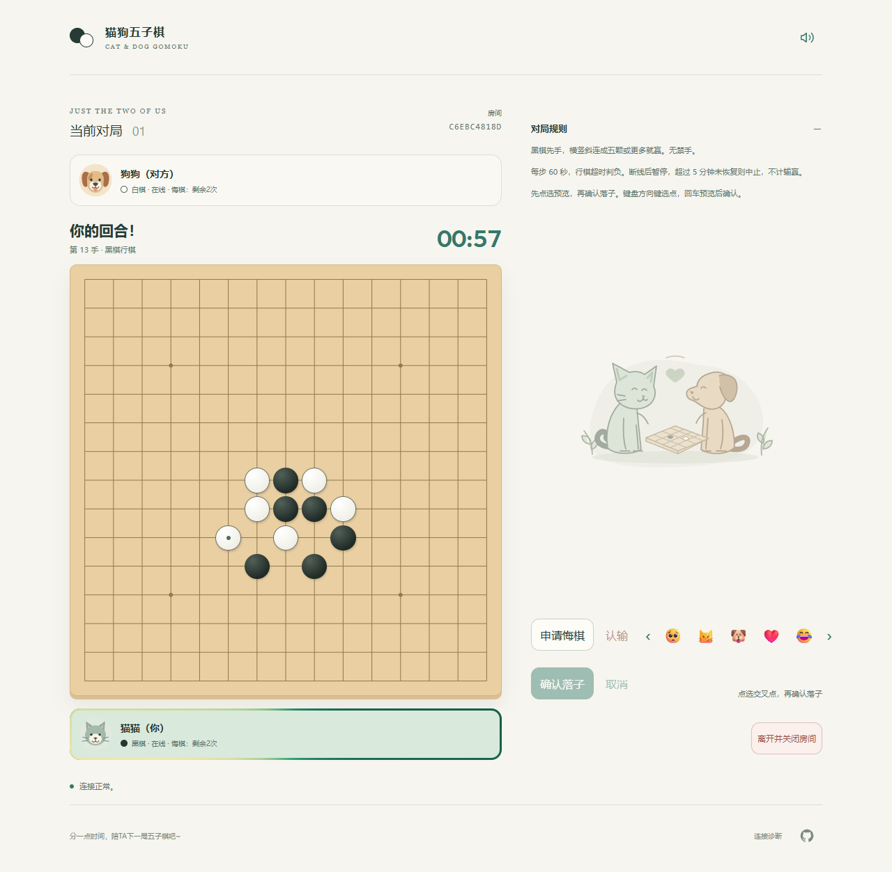
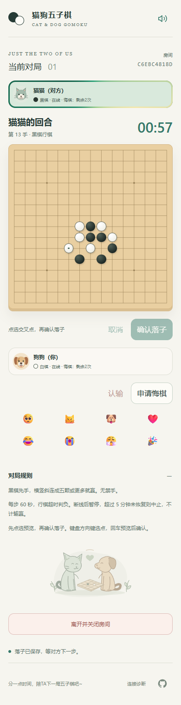

<h1 align="center">🐱 Cat &amp; Dog Gomoku 🐶</h1>

<p align="center"><a href="README.md">English</a> | 简体中文</p>

<p align="center"><a href="https://cat-and-dog-gomoku-d4c9e5cfbbfc0-1513741929.tcloudbaseapp.com/gomoku/">在线游玩</a> | <a href="#截图">截图</a> | <a href="https://github.com/REEEEEAAAAAL/cat-dog-gomoku">源代码</a></p>

一个为两个人设计的在线五子棋小游戏。选择猫猫或狗狗，分享邀请，在 15×15 棋盘上一起下一局。支持手机与电脑，无需注册账号，游戏界面为简体中文。

线上游戏使用有有效期与额度限制的 CloudBase 体验环境，默认域名首次访问可能显示确认页面。

## 功能

- 通过邀请链接或十位房间码加入，房主批准、双方准备后开局。
- 连成五颗或更多棋子获胜。先预览位置，再确认落子，减少误触；支持鼠标、触摸与键盘。
- 服务端管理每回合 60 秒计时，支持断线暂停与刷新恢复；断线五分钟仍未恢复时，本局中止，不判胜负。
- 每人每局最多成功悔棋两次，双方先确认撤销范围，再由对方批准。
- 开局后可随时认输，二次确认后由服务端保存结果，无需对方同意。
- 双方同意后换色再来一局，另有八种固定表情、本地音效和可记住设置的静音开关。

不提供匹配、观战、自由文字聊天或人机对战。邀请用于申请加入，不是玩家身份凭证。恢复对局需要原浏览器会话，其他浏览器不能接管身份。主动离开会为双方关闭房间，房间在 24 小时后过期。

## 核心设计

前端使用严格类型的 TypeScript、Vite、原生 DOM/SVG 与 Web Audio。CloudBase 提供匿名会话、静态托管和 PostgreSQL HTTP RPC 后端。Vitest、PGlite 与 Playwright 分别覆盖规则、SQL 行为和浏览器流程。

- **服务端裁决。** 每次 `gomoku_command` 调用锁定房间行，校验玩家、对局、版本、回合和位置，持久化后才返回确认。浏览器不能直接读写游戏表，预览棋子只有收到服务端确认后才成为正式落子。
- **重试不重复落子。** 操作 ID 与已保存的回执避免丢失响应后重复执行。结果未知时，页面保留待确认操作，供重试与核对。刷新可恢复会话，同一浏览器的新标签页会接管原席位。
- **轮询简化部署。** 活跃的前台页面每五秒轮询一次，对方更新可能延迟一个轮询周期。后台页面停止轮询，候场和终局页面两分钟无操作后也会休息。15 秒心跳租约允许短暂网络波动，过期后暂停对局。
- **恢复后继续原计时。** PostgreSQL 保存截止时间与剩余时间，双方重连并确认同步后才能继续。超时在下一次 RPC 时结算，双方都离线时也遵循这一规则，无需后台定时任务。

当前使用 HTTP 轮询，没有启用 PostgreSQL Realtime。仓库还保留早期 Cloudflare Workers/SQLite Durable Objects 候选实现，供查阅历史，与当前部署分开。

## 本地运行

需要 Node.js 22 或更新版本及 npm，开发已在 Node.js 24 上验证。

```sh
npm ci
```

无需云凭据即可运行完整本地对局，数据库为内存中的 PostgreSQL 兼容实例：

```sh
node node_modules/vite/bin/vite.js --config game.test.config.ts --configLoader runner --host 127.0.0.1 --port 18790
```

在两个独立浏览器配置或普通窗口与无痕窗口中打开 `http://127.0.0.1:18790`，创建房间、分享邀请、批准对方并准备。本地适配器绕过 CloudBase 鉴权，停止服务即丢失数据，不能用于线上部署。

如需连接自己的 CloudBase 后端，将 `.env.example` 复制为 `.env.local`，填写 `VITE_CLOUDBASE_ENV_ID` 与 `VITE_CLOUDBASE_PUBLISHABLE_KEY`，然后运行：

```sh
npm run dev
```

后端需要 PostgreSQL 环境、匿名登录、允许访问的网页来源，以及下述数据库迁移。当前客户端配置上海地域。Vite 变量会写入浏览器构建产物，只能使用前端公开密钥，不能填写管理凭据。

## 测试与构建

```sh
npm run typecheck
npm run lint
npm test
npm run build:cloudbase
```

单元测试在隔离的 PGlite 实例中执行真实 SQL 迁移，并控制服务端时间；同时覆盖协议、规则、音效事件、HTTP 和旧原型会话，不需要云凭据。

浏览器测试默认使用已安装的 Microsoft Edge；设置 `GOMOKU_BROWSER=chrome` 可使用已安装的 Google Chrome。在 PowerShell 中运行本地 SQL 对局测试：

```powershell
$env:GOMOKU_LOCAL_SQL = '1'
npm run test:game-page
Remove-Item Env:GOMOKU_LOCAL_SQL
```

macOS/Linux 可使用 `GOMOKU_LOCAL_SQL=1 GOMOKU_BROWSER=chrome npm run test:game-page`。本地游戏测试阻断 CloudBase 请求，覆盖双人对局、丢失回执、刷新、悔棋、邀请、音效与响应式操作，不验证云端鉴权或实体手机。截图和失败产物写入已忽略的 `test-results/`。

线上测试需显式启用，会在目标环境创建房间和匿名会话。将 `GOMOKU_URL` 设为完整的 `/gomoku/` 地址，或设置 `GOMOKU_LIVE_LOCAL=1`，用构建后的本地预览连接所配置的后端。运行前先清除 `GOMOKU_LOCAL_SQL`。`GOMOKU_LONG_TEST=1` 额外启用五分钟离线用例。`npm run test:cloudbase-page` 检查独立诊断页，其公网测试需要 `CLOUDBASE_DIAGNOSTIC_URL`。

脚本直接调用 Node 入口，以兼容含 `&` 的 Windows 项目路径。CloudBase SDK 目前会触发 Vite 的大包提示，但不影响构建成功。

## 部署

使用自己的 CloudBase PostgreSQL 环境及已登录的 CLI。替换 `cloudbaserc.json` 中的项目环境 ID，配置匿名登录与允许的网页来源，构建前填写 `.env.local`。执行变更前核对目标及计费设置。

```sh
npm run build:cloudbase
tcb db pg migration list --env-id YOUR_ENV_ID
tcb db pg migration up --dry-run --env-id YOUR_ENV_ID
tcb db pg migration up --env-id YOUR_ENV_ID --yes
tcb db pg migration list --env-id YOUR_ENV_ID
tcb hosting deploy ./dist/cloudbase/game gomoku --env-id YOUR_ENV_ID --verify
```

按顺序应用 `cloudbase/migrations/` 中的文件，不修改已应用的迁移。其中包含独立诊断结构与游戏结构。构建将游戏放入 `dist/cloudbase/game/`，诊断页放入 `dist/cloudbase/site/`，SQL 放入 `dist/cloudbase/database/`。只上传所需前端目录，诊断页可单独部署至 `gomoku-diag/`。

邀请使用 URL 片段，无需额外的服务端路由配置。替换前保存上一版前端构建，保留旧哈希资源；需要回退时避免使用 `--prune`。恢复保存的前端构建即可回退网页，数据库恢复需单独评估，不删除迁移历史。

## 目录

| 路径 | 用途 |
| --- | --- |
| `src/game/`、`game/` | 当前游戏界面、协议、会话和静态资源 |
| `cloudbase/migrations/` | 有序 PostgreSQL 迁移与权威游戏 RPC |
| `tests/` | 单元、SQL、浏览器测试及本地 SQL 适配器 |
| `diagnostics/cloudbase/` | 独立连接与计时诊断，以及共享 HTTP 工具 |
| `src/worker/`、`src/client/`、`src/shared/` | 早期 Cloudflare 候选实现及其会话模型 |

根目录的 `index.html`、`public/`、`vite.config.ts`、`wrangler.jsonc` 和生成的 Worker 类型用于旧候选实现，对应命令带 `:legacy-cloudflare` 后缀。当前构建入口是 `build:cloudbase`。

## 截图

使用当前界面和真实 SQL 迁移，在本地双浏览器对局中截取。手机图使用模拟视口。





## 许可

项目代码采用 [MIT 许可证](LICENSE)。内置录音使用 CC0，来源与处理方式见 [sounds/LICENSE.txt](game/public/sounds/LICENSE.txt)。内置 Outfit 字体保留其 [SIL Open Font License](game/public/fonts/OFL-Outfit.txt)。
